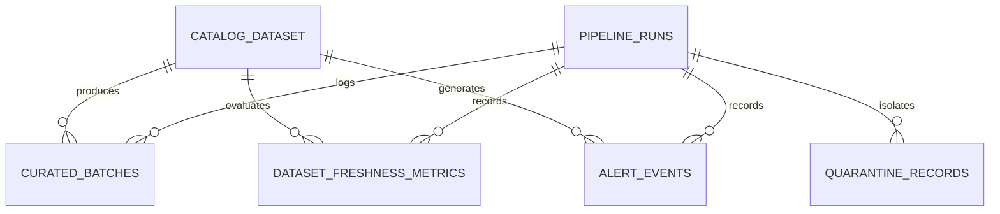

# Data Dictionary: SLA and Freshness Sentinel

This document formally defines the entities, keys, grain, relationships, nullability, constraints, derived formulas, and business rules governing the SLA & Freshness Sentinel platform.

---

## Entity-Relationship Diagram (ERD) Overview

---

## 1. Table: `curated_batches`

- **Description:** Stores successfully ingested, schema-validated dataset batch arrival records with computed delay and SLA breach flags.
- **Grain:** One row per dataset batch arrival ingestion attempt.
- **Storage Path:** Embedded DuckDB (`data/warehouse/sla_sentinel.duckdb`).

| Column Name | Data Type | Nullable | Primary Key | Foreign Key | Description & Business Rules |
| :--- | :--- | :---: | :---: | :---: | :--- |
| `batch_id` | `VARCHAR` | No | **Yes** | — | Unique deterministic identifier of the landed batch. Stable across reruns. |
| `dataset_id` | `VARCHAR` | No | No | `catalog.dataset_id` | Foreign key referencing the active SLA catalog. |
| `schedule_interval_start` | `TIMESTAMP` | No | No | — | Start of the schedule cadence partition (UTC). |
| `schedule_interval_end` | `TIMESTAMP` | No | No | — | End of the schedule cadence partition (UTC). Constraint: `>= schedule_interval_start`. |
| `expected_arrival_time` | `TIMESTAMP` | No | No | — | Scheduled arrival timestamp based on offset minutes (UTC). |
| `actual_arrival_time` | `TIMESTAMP` | No | No | — | Timestamp when batch data landed on storage/landing zone (UTC). |
| `actual_completion_time` | `TIMESTAMP` | Yes | No | — | Timestamp when downstream pipeline finished ingestion/processing. Null if in-progress or failed. |
| `max_event_timestamp` | `TIMESTAMP` | Yes | No | — | Watermark of the latest event inside the dataset payload. |
| `row_count` | `BIGINT` | No | No | — | Total records in batch. Constraint: `>= 0`. |
| `bytes_size` | `BIGINT` | No | No | — | Size of payload in bytes. Constraint: `>= 0`. |
| `status` | `VARCHAR` | No | No | — | Ingestion status enum: `SUCCESS`, `FAILED`, `PARTIAL`, `IN_PROGRESS`. |
| `arrival_delay_seconds` | `DOUBLE` | No | No | — | `max(0, (actual_arrival_time - expected_arrival_time).seconds)`. |
| `is_late_arrival` | `BOOLEAN` | No | No | — | `True` if `arrival_delay_seconds > arrival_grace_minutes * 60`. |
| `pipeline_duration_seconds` | `DOUBLE` | Yes | No | — | Duration of processing: `actual_completion_time - actual_arrival_time`. |
| `sla_completion_deadline` | `TIMESTAMP` | Yes | No | — | `actual_arrival_time + timedelta(minutes=sla_duration_minutes)`. |
| `is_sla_breached` | `BOOLEAN` | No | No | — | `True` if `status == 'FAILED'` or `pipeline_duration_seconds > sla_duration_sec`. |
| `source_file` | `VARCHAR` | No | No | — | Originating landing file URI or local path. |
| `producer_id` | `VARCHAR` | No | No | — | Subsystem / producer producing this batch. |
| `ingestion_run_id` | `VARCHAR` | No | No | `pipeline_runs.run_id` | Foreign key tracing the pipeline run that inserted/updated this row. |
| `processed_at` | `TIMESTAMP` | No | No | — | Ingestion timestamp (UTC). |

---

## 2. Table: `dataset_freshness_metrics`

- **Description:** Snapshot table tracking data freshness lag, watermark drift, and staleness status per dataset.
- **Grain:** One row per dataset per evaluation timestamp.

| Column Name | Data Type | Nullable | Primary Key | Foreign Key | Description & Business Rules |
| :--- | :--- | :---: | :---: | :---: | :--- |
| `metric_id` | `VARCHAR` | No | **Yes** | — | Deterministic hash: `sha256(dataset_id + ":" + as_of_time)[:16]`. |
| `dataset_id` | `VARCHAR` | No | No | `catalog.dataset_id` | Identifier of monitored dataset. |
| `as_of_time` | `TIMESTAMP` | No | No | — | Point-in-time timestamp at which freshness was evaluated (UTC). |
| `last_successful_batch_id` | `VARCHAR` | Yes | No | `curated_batches.batch_id` | Latest successful batch identified in warehouse. |
| `last_successful_load_time` | `TIMESTAMP` | Yes | No | — | Ingestion completion timestamp of the latest successful batch. |
| `max_event_timestamp` | `TIMESTAMP` | Yes | No | — | Watermark of the latest event in the dataset. |
| `freshness_lag_seconds` | `DOUBLE` | No | No | — | `as_of_time - max_event_timestamp` in seconds. |
| `freshness_lag_minutes` | `DOUBLE` | No | No | — | `freshness_lag_seconds / 60.0`. |
| `max_acceptable_freshness_minutes` | `DOUBLE` | No | No | — | Threshold from SLA catalog beyond which data is stale. |
| `freshness_status` | `VARCHAR` | No | No | — | Categorization: `FRESH` (lag <= threshold), `STALE_WARNING` (threshold < lag <= 1.5*threshold), `CRITICAL_STALE` (lag > 1.5*threshold). |
| `is_freshness_sla_breached` | `BOOLEAN` | No | No | — | `True` if `freshness_lag_minutes > max_acceptable_freshness_minutes`. |
| `evaluated_run_id` | `VARCHAR` | No | No | `pipeline_runs.run_id` | Run ID of pipeline execution. |

---

## 3. Table: `alert_events`

- **Description:** Stores actionable alerts generated by SLA detection, missing load scans, staleness detection, and data anomalies.
- **Grain:** One row per unique incident (deduplicated by `dedup_key`).

| Column Name | Data Type | Nullable | Primary Key | Foreign Key | Description & Business Rules |
| :--- | :--- | :---: | :---: | :---: | :--- |
| `alert_id` | `VARCHAR` | No | **Yes** | — | Deterministic hash: `sha256(dataset_id + ":" + dedup_key)[:16]`. |
| `dataset_id` | `VARCHAR` | No | No | `catalog.dataset_id` | Associated dataset identifier. |
| `alert_type` | `VARCHAR` | No | No | — | Enum: `MISSING_LOAD`, `LATE_ARRIVAL`, `SLA_BREACH`, `STALE_DATA`, `DATA_QUALITY_ANOMALY`. |
| `severity` | `VARCHAR` | No | No | — | Priority rank: `CRITICAL` (P1 impact), `WARNING` (P2 impact), `INFO` (P3 impact). |
| `status` | `VARCHAR` | No | No | — | Lifecycle status: `OPEN`, `ACKNOWLEDGED`, `RESOLVED`. |
| `schedule_interval_start` | `TIMESTAMP` | Yes | No | — | Scheduled interval associated with incident. |
| `expected_time` | `TIMESTAMP` | Yes | No | — | Expected arrival or completion deadline (UTC). |
| `actual_time` | `TIMESTAMP` | Yes | No | — | Actual event time or null if load never arrived. |
| `delay_minutes` | `DOUBLE` | No | No | — | Total delay in minutes beyond scheduled SLA. |
| `alert_title` | `VARCHAR` | No | No | — | Human-readable alert summary. |
| `alert_message` | `VARCHAR` | No | No | — | Comprehensive incident diagnostics. |
| `recommended_action` | `VARCHAR` | No | No | — | Specific runbook instructions for on-call engineers. |
| `owner_team` | `VARCHAR` | No | No | — | Escalation target email or channel (e.g. `order-ops@company.internal`). |
| `dedup_key` | `VARCHAR` | No | No | — | Deterministic string e.g. `{dataset_id}:{slot}:{alert_type}` preventing duplicate alert noise. |
| `triggered_at` | `TIMESTAMP` | No | No | — | Timestamp alert was generated (UTC). |
| `run_id` | `VARCHAR` | No | No | `pipeline_runs.run_id` | Pipeline run that triggered this alert. |

---

## 4. Table: `quarantine_records`

- **Description:** Isolates invalid, malformed, or rejected records with complete source traceability.
- **Grain:** One row per rejected raw record.

| Column Name | Data Type | Nullable | Primary Key | Foreign Key | Description & Business Rules |
| :--- | :--- | :---: | :---: | :---: | :--- |
| `quarantine_id` | `VARCHAR` | No | **Yes** | — | Deterministic hash: `sha256(run_id + ":" + source_file + ":" + line + ":" + raw)[:16]`. |
| `run_id` | `VARCHAR` | No | No | `pipeline_runs.run_id` | Pipeline execution that caught this violation. |
| `source_file` | `VARCHAR` | No | No | — | Origin file path or URI. |
| `line_number` | `INTEGER` | No | No | — | 1-indexed line number in source file for exact triage. |
| `raw_record` | `TEXT` | No | No | — | Exact raw content of unparseable or rejected payload. |
| `reject_code` | `VARCHAR` | No | No | — | Classification: `MALFORMED_JSON`, `MISSING_REQUIRED_FIELD`, `SCHEMA_VALIDATION_ERROR`, `NEGATIVE_ROW_COUNT`, `UNKNOWN_DATASET_ID`, `DUPLICATE_KEY_IN_BATCH`, `INVALID_SCHEDULE_WINDOW`, `INVALID_TIMESTAMP`. |
| `reject_reason` | `TEXT` | No | No | — | Detailed diagnostics and field-level error messages. |
| `rejected_at` | `TIMESTAMP` | No | No | — | Rejection isolation timestamp (UTC). |

---

## 5. Table: `pipeline_runs`

- **Description:** Operational metadata and audit trail for every pipeline execution.
- **Grain:** One row per pipeline execution run.

| Column Name | Data Type | Nullable | Primary Key | Foreign Key | Description & Business Rules |
| :--- | :--- | :---: | :---: | :---: | :--- |
| `run_id` | `VARCHAR` | No | **Yes** | — | Unique run identifier e.g. `run_YYYYMMDD_HHMMSS_UUID`. |
| `pipeline_name` | `VARCHAR` | No | No | — | Name of pipeline workflow (`sla_freshness_pipeline`). |
| `started_at` | `TIMESTAMP` | No | No | — | Execution start timestamp (UTC). |
| `completed_at` | `TIMESTAMP` | Yes | No | — | Execution completion timestamp (UTC). |
| `status` | `VARCHAR` | No | No | — | `SUCCESS`, `PARTIAL_SUCCESS` (quarantined records isolated), or `FAILED`. |
| `input_records_count` | `BIGINT` | No | No | — | Total raw input records scanned. |
| `valid_records_count` | `BIGINT` | No | No | — | Count of validated records passed to target tables. |
| `quarantined_records_count` | `BIGINT` | No | No | — | Count of rejected records sent to quarantine. |
| `alerts_generated_count` | `BIGINT` | No | No | — | Count of alerts issued. |
| `execution_duration_sec` | `DOUBLE` | No | No | — | Total wall-clock execution duration in seconds. |
| `error_message` | `TEXT` | Yes | No | — | Stack trace or exception message if pipeline crashed. |

---

## 6. Mathematical Conservation Invariant

Every pipeline run strictly adheres to the fundamental conservation formula:

$$\text{Input Records Count} = \text{Valid Records Count} + \text{Quarantined Records Count}$$

Any discrepancy ($\neq 0$) is immediately flagged as an integrity assertion error in reconciliation reports.
