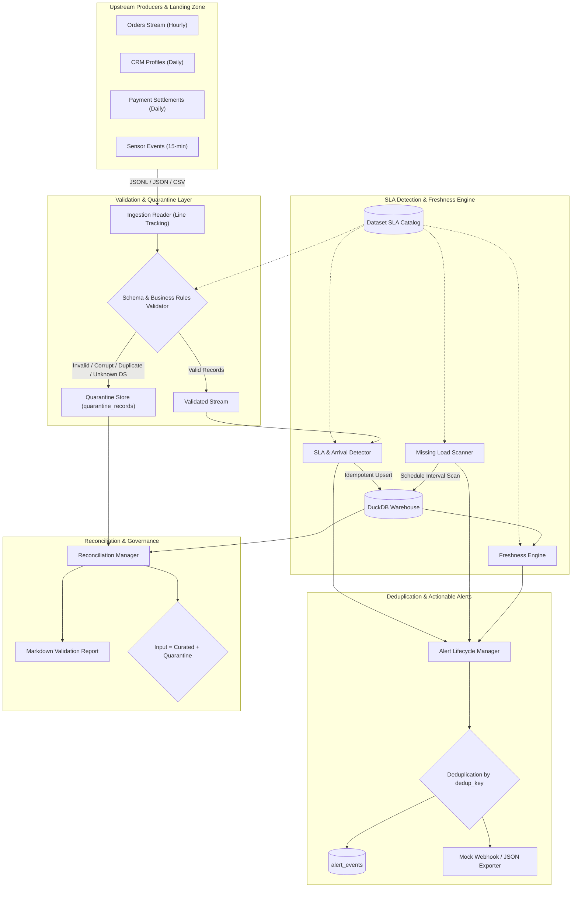

# SLA & Freshness Sentinel 🛰️

> Production-Grade Data Engineering Platform for Tracking Dataset Arrival Times, Completion SLAs, Freshness Lags, and Actionable Incident Alerting.

[](https://www.python.org/)
[](https://duckdb.org/)
[](https://docs.pydantic.dev/)
[]()
[]()

---

## 1. Business Problem & Objective

Modern analytical platforms rely on dozens of upstream source systems, CDC streams, third-party vendor APIs, and scheduled batch jobs. When data arrives late, fails silently, or gets delayed in transit, downstream dashboards and machine learning models operate on stale data without engineers being alerted until executives notice the discrepancies.

**SLA & Freshness Sentinel** solves this problem by providing:
1. **Configurable SLA Catalog:** Centralized YAML configuration of arrival schedules, grace periods, completion SLA deadlines, and freshness thresholds across diverse cadences (15-minute, hourly, 6-hour, daily).
2. **Deterministic Ingestion & Quarantine:** Strict Pydantic v2 validation isolating malformed, duplicate, or out-of-spec records with line-level traceability.
3. **Automated Incident Detection:**
   - **Late Arrivals:** Catches data landing after expected time + grace period.
   - **SLA Breaches:** Catches pipelines exceeding execution time budgets or ending in `FAILED` status.
   - **Missing Loads:** Scans expected schedule intervals and detects unlanded partitions during upstream silence.
   - **Staleness Tracking:** Calculates true watermark freshness lag against configurable freshness SLAs.
4. **Actionable Alerts:** Deduplicated, severity-ranked incident notifications with step-by-step runbooks for on-call engineers.
5. **Mathematical Conservation & Audit:** Continuous proof that $\text{Input} = \text{Curated} + \text{Quarantined}$ with zero duplicate insertions across arbitrary retries.

---

## 2. End-to-End Architecture



---

## 3. Project Structure

```
yottaflex/
├── README.md                      # Comprehensive user guide & architecture
├── DATA_DICTIONARY.md             # Schemas, keys, grain, relationships, formulas
├── DESIGN_AND_TRADEOFFS.md        # Architectural choices and performance analysis
├── pyproject.toml                 # Package definition & pytest config
├── requirements.txt               # Locked dependencies
├── config/
│   ├── default_config.yaml        # Runtime database, quarantine, and logging paths
│   └── datasets_sla_catalog.yaml  # Configured datasets, expected arrival windows, SLAs
├── src/
│   ├── cli.py                     # Rich CLI interface (generate, run, reconcile, benchmark)
│   ├── config.py                  # Pydantic configuration loader & catalog parser
│   ├── utils.py                   # Timezone normalization & helpers
│   ├── pipeline.py                # Main orchestrator
│   ├── models/                    # Pydantic data schemas
│   │   ├── raw.py                 # Raw ingestion model
│   │   ├── target.py              # CuratedBatchRecord, FreshnessMetric, AlertEvent
│   │   ├── quarantine.py          # QuarantineRecord & RejectCode enum
│   │   └── audit.py               # PipelineRunRecord
│   ├── generator/
│   │   └── synthetic_data.py      # Reproducible synthetic generator (sample & 100k+)
│   ├── ingestion/
│   │   ├── reader.py              # File reader (JSON, JSONL, CSV) with line tracking
│   │   └── validator.py           # Schema, duplicate, and catalog referential validator
│   ├── engine/
│   │   ├── database.py            # DuckDB manager with idempotent transactions (UTC)
│   │   ├── detector.py            # Late arrival, SLA breach & missing load detector
│   │   ├── freshness.py           # Freshness lag calculator & staleness classifier
│   │   └── alert_manager.py       # Deduplication & alert dispatcher
│   ├── reconciliation/
│   │   └── reconciler.py          # Mathematical conservation checks & report generator
│   └── benchmark/
│       └── performance.py         # Baseline vs optimized throughput profiler
├── data/
│   ├── sample/                    # Small starter sample & expected ground-truth labels
│   ├── warehouse/                 # DuckDB target warehouse & quarantine logs
│   └── reports/                   # Generated validation reports and active alerts
└── tests/
    ├── conftest.py                # Shared pytest fixtures & mock catalogs
    ├── test_happy_path.py         # Valid batch ingestion & empty input tests
    ├── test_validation_edge_cases.py # Malformed JSON, nulls, negative rows, inverted windows
    ├── test_sla_detection.py      # Late arrivals, SLA duration breach, freshness staleness
    ├── test_idempotency.py        # Safe reruns & retry status updates
    ├── test_domain_edge_cases.py  # Out-of-order batches, midnight crossing, zero-row loads
    └── test_reconciliation.py     # Conservation proofs & Markdown report assertions
```

---

## 4. Setup Instructions

### Prerequisites
- Python 3.10+ (tested and verified on Python 3.14)
- Git

### Installation
Clone the repository and install dependencies:
```bash
pip install -r requirements.txt
```

---

## 5. Quickstart & CLI Commands

The platform includes a CLI tool (`src/cli.py`) with intuitive commands.

### 1. Generate Starter Sample Dataset
Generates a curated 14-record dataset containing normal data, boundary conditions, and deliberate negative edge cases, alongside a separate `expected_labels.json` file for validation:
```bash
python src/cli.py generate-sample
```
*Output files:* `data/sample/starter_batches.jsonl` and `data/sample/expected_labels.json`.

### 2. Run Ingestion, SLA Detection & Freshness Pipeline
Execute the pipeline over the sample dataset:
```bash
python src/cli.py run --input data/sample/starter_batches.jsonl --eval-time 2026-10-27T14:00:00+00:00 --reconcile
```
*Key Actions Performed:*
- Scans `starter_batches.jsonl` line by line.
- Validates each record; routes 6 malformed/invalid records to quarantine.
- Upserts 8 valid batch records into `curated_batches`.
- Scans for missing loads across all datasets for the past 48 hours.
- Evaluates dataset freshness watermarks and classifies staleness.
- Deduplicates and issues alerts to `alert_events` and `data/reports/alerts/active_alerts.json`.
- Runs conservation check and outputs `data/reports/validation_report.md`.

### 3. Verify Idempotency (Safe Rerun)
Re-execute the exact same command:
```bash
python src/cli.py run --input data/sample/starter_batches.jsonl --eval-time 2026-10-27T14:00:00+00:00 --reconcile
```
*Result:* Primary keys prevent duplicate insertions. Curated count remains exactly 8, and alert count remains exactly distinct.

### 4. Run Reconciliation Audit
Audit any historical pipeline execution:
```bash
python src/cli.py reconcile
```

### 5. Generate Scalable High-Volume Dataset (100,000+ Records)
Generate a scalable synthetic dataset with a fixed random seed:
```bash
python src/cli.py generate-large --count 100000 --seed 42 --output data/raw/large_batches.jsonl
```

### 6. Run Performance Benchmark
Profile throughput comparing naive row-by-row commits against vectorized batch chunking:
```bash
python src/cli.py benchmark --count 25000
```

---

## 6. Automated Test Suite (21 Tests)

Run the full automated test suite with pytest:
```bash
pytest
```

### Test Coverage Highlights:
- **Happy Path:** `test_happy_path_single_batch` verifies valid ingestion, curated landing, and run audit.
- **Empty Input:** `test_empty_input_batch` ensures zero-byte / zero-record batches execute safely without crashing.
- **Malformed Input:** `test_malformed_json_syntax` catches unparseable JSON and verifies line-level quarantine isolation.
- **Missing Required Fields:** `test_missing_required_fields` catches omitted critical keys.
- **Null Fields:** `test_null_critical_field` catches explicit nulls in required columns.
- **Duplicate Handling:** `test_in_batch_duplicate_primary_key` isolates duplicate keys within the same file.
- **Referential Integrity:** `test_referential_integrity_unknown_dataset` verifies catalog foreign-key enforcement.
- **Negative Values:** `test_negative_row_count` isolates negative counts and sizes.
- **Inverted Schedule:** `test_inverted_schedule_window` isolates end < start intervals.
- **Late Arrivals:** `test_late_arrival_detection` verifies delay calculation and `LATE_ARRIVAL` alerts.
- **SLA Breaches:** `test_sla_duration_breach` and `test_failed_batch_triggers_sla_breach` verify completion SLA monitoring.
- **Missing Loads:** `test_missing_load_detection` verifies schedule interval synthesis.
- **Freshness Engine:** `test_freshness_engine_evaluation` verifies `FRESH`, `STALE_WARNING`, and `CRITICAL_STALE` thresholds.
- **Idempotency:** `test_pipeline_rerun_idempotency` proves zero row inflation on reruns.
- **Retry Updates:** `test_batch_retry_updates_existing_record` verifies updating `FAILED` batches to `SUCCESS`.
- **Domain Edge Case 1 (Out-of-Order):** `test_out_of_order_batch_arrivals` proves watermark correctness when batches arrive out of order.
- **Domain Edge Case 2 (Midnight Boundary):** `test_midnight_boundary_crossing` proves UTC date boundary safety.
- **Domain Edge Case 3 (Zero-Row Load):** `test_zero_row_valid_batch` handles valid empty holiday loads.
- **Reconciliation Check:** `test_reconciliation_conservation_and_reporting` proves `Input = Curated + Quarantine`.

---

## 7. Sample Reconciliation & Validation Report

```
# Pipeline Reconciliation & SLA Sentinel Validation Report

**Run ID:** `run_20261028_020735_d99a9e2a`  
**Pipeline Status:** `PARTIAL_SUCCESS` (quarantined records isolated)  
**Execution Duration:** `0.5351 seconds`

## 1. Mathematical Conservation & Integrity Check
- **Conservation Equation:** `Input (14) = Curated (8) + Quarantine (6)` -> **✅ PASSED**
- **Discrepancy Count:** `0`
- **Primary Key Violations (Curated Batches):** `0`
- **Primary Key Violations (Alert Events):** `0`
- **Referential Integrity Violations:** `0`

## 2. Ingested Datasets Operational Summary
| Dataset ID | Total Batches | Ingested Rows | Late Batches | SLA Breached | Avg Delay (min) |
| :--- | :---: | :---: | :---: | :---: | :---: |
| `customer_profiles_daily` | 1 | 98,000 | 0 | 0 | 10.0m |
| `orders_stream_hourly` | 6 | 70,600 | 1 | 2 | 7.67m |
| `payments_settlement_daily` | 1 | 520,000 | 0 | 0 | 5.0m |

## 3. Dataset Freshness & SLA Lag Overview
| Dataset ID | Freshness Status | Current Lag (min) | Max Allowed (min) | SLA Breached |
| :--- | :---: | :---: | :---: | :---: |
| `orders_stream_hourly` | 🟢 `FRESH` | 95.0m | 120.0m | False |
| `payments_settlement_daily` | 🟢 `FRESH` | 151.0m | 1500.0m | False |
| `customer_profiles_daily` | 🟢 `FRESH` | 271.0m | 1560.0m | False |
| `clickstream_events_15m` | 🔴 `CRITICAL_STALE` | 14400.0m | 30.0m | True |
| `inventory_snapshots_6h` | 🔴 `CRITICAL_STALE` | 14400.0m | 480.0m | True |
```

---

## 8. Actionable Alert Sample

Alerts generated by the engine contain context and runbooks:

```json
{
  "alert_id": "902d7eb74a6be268",
  "dataset_id": "orders_stream_hourly",
  "alert_type": "LATE_ARRIVAL",
  "severity": "CRITICAL",
  "status": "OPEN",
  "delay_minutes": 35.0,
  "alert_title": "Late Arrival: E-Commerce Hourly Order Ingestion exceeded grace period by 25.0m",
  "alert_message": "Dataset 'orders_stream_hourly' arrived at 2026-10-27T04:50:00+00:00, which is 35.0 minutes after expected time 2026-10-27T04:15:00+00:00 (Grace period: 10 mins).",
  "recommended_action": "1. Check upstream producer s3-order-collector logs for delay cause. 2. Verify whether downstream consumption DAGs for orders_stream_hourly were delayed. 3. Escalate to owning team order-ops@company.internal if persistent.",
  "owner_team": "order-ops@company.internal",
  "dedup_key": "orders_stream_hourly:2026-10-27T03:00:00+00:00:LATE_ARRIVAL"
}
```

---

## 9. Design Decisions & Documentation Links

- **[Data Dictionary](DATA_DICTIONARY.md):** Complete schemas, data types, keys, relationships, nullability, and formulas.
- **[Design and Trade-offs](DESIGN_AND_TRADEOFFS.md):** In-depth engineering rationale on DuckDB storage, idempotency, vectorized vs row-by-row performance, and roadmap.
- **[AI Collaboration & Prompt Disclosure Log](AI_PROMPTS.md):** Complete log of all user prompts, AI tooling disclosures, and verification records per Yottaflex submission guidelines.
